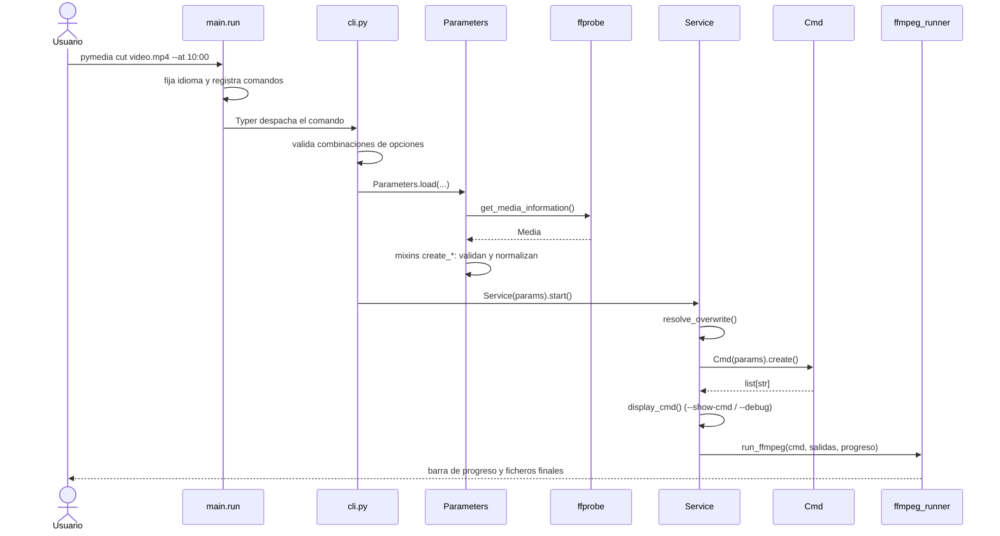
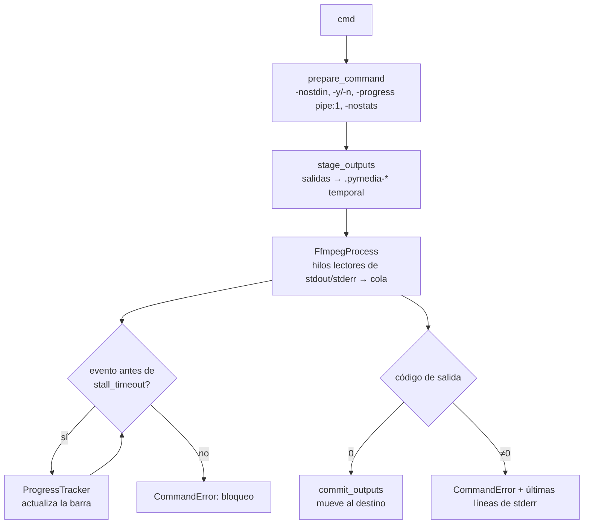
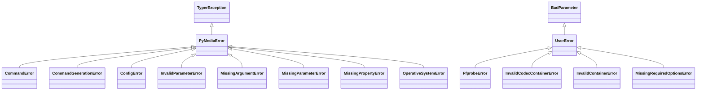

# Arquitectura

pyMedia sigue una arquitectura en capas: cada comando separa la interfaz de línea de
comandos, la validación de parámetros, la composición del comando ffmpeg y la
ejecución. Las piezas compartidas viven en mixins, modelos y catálogos de datos.

## Mapa del código

```text
src/pymedia/
├── __init__.py          # Versión del paquete (fuente única para hatchling)
├── main.py              # Punto de entrada: idioma, registro de comandos y run()
├── commands/
│   ├── base/            # Piezas comunes a todos los comandos
│   │   ├── cli.py           # Typer base, callbacks (--help, --version) y validadores de rutas
│   │   ├── cli_options.py   # Opciones y argumentos Typer reutilizables (Annotated)
│   │   ├── parameters.py    # BaseParameters: carga Config y Logger
│   │   ├── service.py       # BaseService: sobrescritura, --show-cmd/--debug, run_ffmpeg
│   │   └── ffmpeg_runner.py # Ejecución de ffmpeg: staging, progreso, bloqueos
│   ├── main/            # Callback raíz (ayuda, versión, comprobación de ffmpeg)
│   └── <comando>/       # Un paquete por comando
│       ├── cli.py           # Función Typer: opciones, validación de combinaciones
│       ├── parameters.py    # Dataclass de parámetros (compone mixins) + load()
│       ├── cmd.py           # Composición pura del comando ffmpeg (list[str])
│       └── service.py       # Orquestación: salidas, mostrar/ejecutar, mensajes
├── mixins/              # Validación y fragmentos de comando reutilizables
├── models/              # Dataclasses: Media, Video, Audio, Subtitles, Chapter, Config…
├── data/                # Catálogos de códecs, contenedores, formatos e idiomas
├── ffprobe.py           # Lectura de metadatos con ffprobe → modelos
├── utils.py             # Conversión de valores de ffprobe (fechas, fracciones…)
├── errors.py            # Jerarquía de excepciones localizadas
├── logger.py            # Logger dual: consola Rich + fichero rotativo
├── theme.py             # Paleta y estilos con nombre de la interfaz
├── ui.py                # Consola temática, preguntas, barra de progreso, ayuda de Typer
├── locale_manager.py    # Detección de idioma y carga de catálogos gettext
├── locales/             # pymedia.pot y catálogos <idioma>/LC_MESSAGES
├── types.py             # Enums compartidos (modos, perfiles, tipos de pista)
└── resources/           # config.toml por defecto, iconos, tipografía, man page
```

## Flujo de un comando



## Responsabilidades por capa

| Capa              | Hace                                                                 | No hace                                  |
|-------------------|----------------------------------------------------------------------|------------------------------------------|
| `cli.py`          | Declara opciones con tipos de `cli_options.py`; rechaza combinaciones imposibles; crea el `Logger`; carga parámetros y arranca el servicio. | Validar contra el fichero, componer ffmpeg. |
| `parameters.py`   | Hereda de `BaseParameters` y de los mixins necesarios; `load()` llama a los `create_*` en orden y deja el objeto listo. | Ejecutar procesos (salvo ffprobe).        |
| `mixins/`         | `create_*`: parsea y valida una opción contra el medio. `to_*_cmd`: devuelve el fragmento de ffmpeg correspondiente. | Conocer el comando concreto que los usa. |
| `cmd.py`          | Función pura: a partir de los parámetros devuelve el comando como `list[str]`. | I/O, logs, preguntas al usuario.         |
| `service.py`      | Hereda de `BaseService`; calcula las salidas esperadas, resuelve la sobrescritura, muestra y ejecuta el comando, informa del resultado. | Parsear opciones.                         |

Esta separación permite testear `cmd.py` comparando listas, los mixins con modelos
sintéticos y los servicios con ffmpeg simulado.

## Mixins

Cada mixin es un `@dataclass(kw_only=True)` con los atributos que gestiona. Los
parámetros de un comando son la composición de los mixins que necesita:

```python
@dataclass(kw_only=True)
class CutParameters(
    BaseParameters,
    MediaInputMixin,
    MediaOutputMixin,
    TimestampAtMixin,
    TimestampStartEndMixin,
    StripMetadataMixin,
): ...
```

| Mixin                                   | Aporta                                                         |
|-----------------------------------------|----------------------------------------------------------------|
| `media_mixin`                           | Entrada(s) de vídeo analizadas con ffprobe.                    |
| `outputs_mixin`                         | Rutas de salida por tipo (media, audio, subtítulos, imagen, animada), validación de nombres y de compatibilidad códec/contenedor. |
| `streams_mixin`                         | Listas `--tracks` validadas contra las pistas del medio.       |
| `timestamps_mixin`                      | `--start`, `--end`, `--at` y la duración del tramo para la barra de progreso. |
| `audio_mixin`, `subtitles_mixin`        | Pistas importadas, edición de metadatos y disposiciones, idioma. |
| `filters_mixin`                         | Encadena `crop_mixin`, `scale_mixin`, `flip_mixin`, `rotate_mixin`. |
| `fps_mixin`, `image_mixin`              | Fotogramas por segundo y calidad/códec de imagen según extensión. |
| `transcode_mixin`                       | Argumentos de códec de vídeo, audio y subtítulos para `transcode`. |
| `remux_mixin`                           | Rotación por metadatos, `--genpts`, orden de pistas.           |
| `sheet_presets_mixin`                   | Preajustes de `sheet` y ancho de miniatura.                    |
| `metadata_mixin`                        | `--strip-disposition` (`-map_metadata -1`).                    |

## Ejecución de ffmpeg

`commands/base/ffmpeg_runner.py` concentra todo lo relacionado con el proceso. Sus
piezas puras se testean por separado del ciclo de vida del proceso.



| Pieza              | Responsabilidad                                                                 |
|--------------------|---------------------------------------------------------------------------------|
| `prepare_command`  | Añade los flags de ejecución desatendida y elimina duplicados del comando. Los `cmd.py` no deben incluir `-y`, `-n`, `-progress` ni `-nostats`. |
| `stage_outputs`    | Redirige cada salida al directorio temporal. Exige nombres de salida únicos.    |
| `FfmpegProcess`    | Gestor de contexto: lanza el proceso, publica cada línea en una cola desde dos hilos y, al salir, mata el proceso si sigue vivo. Conserva las últimas 10 líneas de stderr. |
| `ProgressTracker`  | Progreso por tiempo (`out_time_ms` de `-progress`) o por pasos (líneas `pts_time:` del filtro `showinfo`). |
| `commit_outputs`   | Mueve los ficheros al destino respetando la política de sobrescritura.          |

Cualquier línea de stdout o stderr cuenta como actividad: el control de bloqueo solo
salta si ffmpeg deja de escribir por completo.

`BaseService.run_ffmpeg` es la fachada que usan los servicios: aporta
`stall_timeout`, la política de sobrescritura y el nombre del comando.

## Lectura de metadatos

`ffprobe.py` ejecuta `ffprobe -print_format json` y convierte el resultado en
modelos:

- `get_media_information(path)` → `Media` con su `Video`, listas de `Audio`,
  `Subtitles` y `Chapter`, formato y metadatos globales. Falla si no hay vídeo.
- `get_audio_information(path)` → lista de `Audio`; avisa si el fichero contiene
  vídeo o subtítulos.
- `validate_subtitles_file_codec(path)` comprueba que un fichero de subtítulos externo
  es lo que dice su extensión.

Los valores de ffprobe llegan como texto o `N/A`; `utils.py` los convierte de forma
tolerante (`to_int`, `parse_fraction`, `parse_date`…) y devuelve `None` ante datos
inválidos en lugar de fallar.

## Modelos y datos

- **Modelos** (`models/`): dataclasses `frozen` y `slots`, salvo los metadatos que la
  edición de pistas modifica. `Media.video_bit_rate` estima la tasa de bits si
  ffprobe no la declara.
- **Catálogos** (`data/`): `VIDEO_CODECS`, `AUDIO_CODECS`, `SUBTITLES_FORMATS` y
  `CONTAINERS` declaran para cada códec su codificador, contenedores admitidos y
  destinos seguros para copia. `SUPPORTED` agrupa las extensiones de salida.
  `tests/test_data_consistency.py` garantiza que los catálogos son coherentes entre sí.
- **Configuración** (`models/config.py`): `Config.load()` crea, lee y valida
  `config.toml`. La validación comprueba primero la estructura (tablas y claves) y
  después acumula todos los errores de valor.

## Errores



| Familia        | Cuándo                                                   | Presentación                                                        |
|----------------|----------------------------------------------------------|---------------------------------------------------------------------|
| `UserError`    | Error corregible por el usuario (opción, fichero, valor). | Panel de error de Click/Typer con la ayuda de uso. Se registra en el fichero de log. |
| `PyMediaError` | Error de ejecución, configuración o estado interno.       | Se registra y muestra al crearse; `main.run()` termina con código 1 sin traza. |

Reglas:

- Los mensajes se construyen con `_("msgid") % {...}` en el momento de lanzarse, para
  usar el idioma activo.
- Nunca se silencia un error: se traduce a la excepción de pyMedia adecuada con
  `raise ... from err`.
- Las funciones públicas documentan en `Raises` también las excepciones de las
  privadas que llaman.

## Registro

`Logger.create(debug)` configura una vez el logger raíz con dos destinos filtrados por
registro: consola (Rich) y fichero (`TimedRotatingFileHandler`, 7 días). Cada llamada
puede elegir destino (`console=False`, `file=False`), lo que permite, por ejemplo,
registrar en fichero un error que Click ya muestra en pantalla.

En consola, cada mensaje lleva un icono por nivel y los valores interpolados
(`%(output)s`…) se resaltan. El fichero recibe siempre el texto plano.

| Método      | Icono | Uso                                               |
|-------------|:-----:|---------------------------------------------------|
| `debug`     | `•`   | Detalle interno (solo con `--debug`).             |
| `info`      | `ℹ`   | Información neutra.                               |
| `success`   | `✔`   | Resultado satisfactorio de una operación.         |
| `warning`   | `▲`   | Aviso que no detiene el proceso.                  |
| `error`     | `✖`   | Error; lo emiten las excepciones `PyMediaError`.  |

Los mensajes son texto plano: los corchetes se muestran tal cual (no se interpretan
como markup de Rich).

## Interfaz y tema

- `theme.py` define la paleta y **estilos con nombre** (`primary`, `success`,
  `heading`, `border`, `table.header`, `cmd.flag`…). Las pantallas usan siempre esos
  nombres, nunca colores sueltos.
- `ui.py` concentra lo que se pinta en el terminal:

| Elemento               | Responsabilidad                                                      |
|------------------------|----------------------------------------------------------------------|
| `console`              | Consola única con el tema; la usan el logger, las tablas y la barra. |
| `confirm()`            | Pregunta sí/no temática; acepta `y/yes/s/sí` y `n/no`; EOF aborta.   |
| `new_progress()`       | Barra de progreso: estado, descripción, barra, porcentaje y tiempo.  |
| `styled_help()`        | Colorea cabeceras y ejemplos de la ayuda sin tocar los `msgid`.      |
| `install_typer_theme()`| Aplica el tema a la ayuda y a los paneles de error de Typer (lo llama `main`). |

- El cuerpo del texto usa el color por defecto del terminal, para leerse en fondos
  claros y oscuros; el color se reserva para iconos, cabeceras y valores.
- `--show-cmd` colorea el comando por tipo de token (`format_cmd`) sin alterar el
  texto, que sigue siendo copiable.

## Internacionalización

- Los textos del código son `msgid` en inglés envueltos en `_()`
  (`from pymedia.locales import translate as _`).
- `locale_manager` decide el idioma (`PYMEDIA_LANG` > `config.toml` > sistema >
  inglés) y carga `locales/<idioma>/LC_MESSAGES/pymedia.mo`.
- `main._configure_runtime()` fija el idioma **antes** de importar los comandos,
  porque los textos de ayuda se evalúan al definir las opciones Typer.
- El flujo de mantenimiento de catálogos está en [Contribuir](contribuir.md#traducciones).
