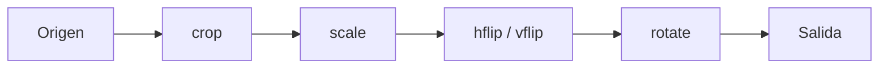

# Filtros de imagen

Disponibles en `transcode`, `animated`, `frames`, `interval` y `scene`. En `transcode`,
cualquier filtro obliga a recodificar el vídeo.

| Opción              | Formato              | Ejemplo                  |
|---------------------|----------------------|--------------------------|
| `--crop`            | `ANCHO,ALTO,X,Y`     | `--crop 1280,720,320,180` |
| `--size`            | `ANCHOxALTO`         | `--size 1280x720`        |
| `--mode`            | `fit`, `stretch`, `cover` | `--mode cover`      |
| `--upscale`         | —                    | `--upscale`              |
| `--rotate`          | `90`, `180`, `270`   | `--rotate 90`            |
| `--hflip`, `--vflip`| —                    | `--hflip`                |

## Orden de aplicación

Los filtros se encadenan siempre en este orden, con independencia del orden en que
escribas las opciones:



Consecuencias prácticas:

- `--crop` se expresa en coordenadas del vídeo **original**.
- `--size` se aplica a la imagen ya recortada.
- `--size` se refiere a la imagen **antes** de girarla: para un vídeo horizontal que
  quieres vertical con `--rotate 90`, indica el tamaño en horizontal.

## `--crop`

Conserva un rectángulo de `ANCHO × ALTO` píxeles cuya esquina superior izquierda está
en `X,Y`.

```text
(0,0) ┌──────────────────────────────┐
      │        (X,Y) ┌──────────┐    │
      │              │  ANCHO   │    │
      │              │ × ALTO   │    │
      │              └──────────┘    │
      └──────────────────────────────┘
```

- Ancho y alto deben ser mayores que 0.
- El rectángulo debe caber en el vídeo: `X + ANCHO` y `Y + ALTO` no pueden superar
  las dimensiones de origen.
- Ejemplo: quitar bandas negras de 140 px arriba y abajo en un 1920×1080:
  `--crop 1920,800,0,140`.

## `--size`, `--mode` y `--upscale`

`--size` fija la resolución objetivo y `--mode` decide cómo encajar la imagen:

| Modo            | Mantiene proporción | Resultado con origen 1920×1080 y `--size 1000x1000` |
|-----------------|:-------------------:|------------------------------------------------------|
| `fit` (defecto) | Sí                  | 1000×562: cabe entera dentro del objetivo.           |
| `cover`         | Sí                  | 1778×1000: cubre por completo el objetivo.           |
| `stretch`       | No                  | 1000×1000: deforma la imagen.                        |

- En `fit` y `cover` pyMedia calcula una dimensión y deja que ffmpeg derive la otra
  manteniendo la proporción. En vídeo, la dimensión derivada se redondea a número
  par, como exigen la mayoría de códecs.
- En vídeo, los valores de `--size` deben ser pares.
- Sin `--upscale`, pyMedia **no amplía**: si el objetivo es mayor que el origen,
  ignora el escalado y muestra un aviso. Ampliar no añade detalle; úsalo solo si
  necesitas una resolución concreta.
- Si el objetivo coincide con la resolución de origen, el filtro se omite.
- `animated` usa por defecto `--size 640x360` y el escalado de alta calidad Lanczos.

## `--rotate`

Gira la imagen en múltiplos de 90° en sentido horario (`270` equivale a 90° en
sentido antihorario). Recodifica los píxeles.

Para corregir solo la orientación de un vídeo de móvil sin recodificar, usa
`remux --rotate`, que cambia los metadatos de orientación (ver
[`remux`](comandos/video.md#remux)).

## `--hflip` y `--vflip`

Voltean la imagen como un espejo: `--hflip` intercambia izquierda y derecha;
`--vflip`, arriba y abajo. Pueden combinarse; ambos a la vez equivalen a
`--rotate 180`.
